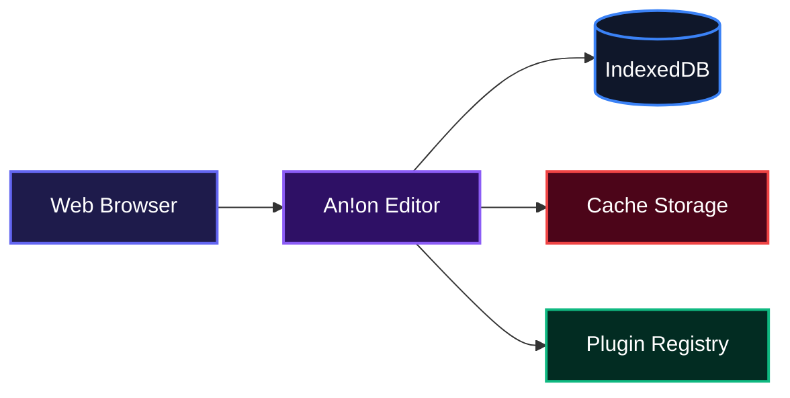
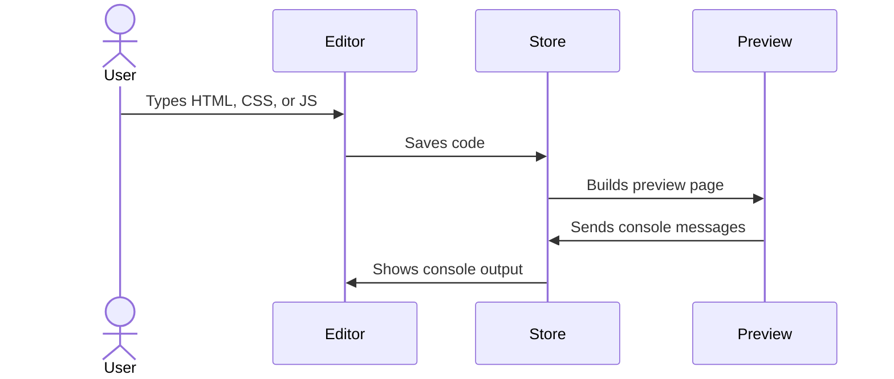
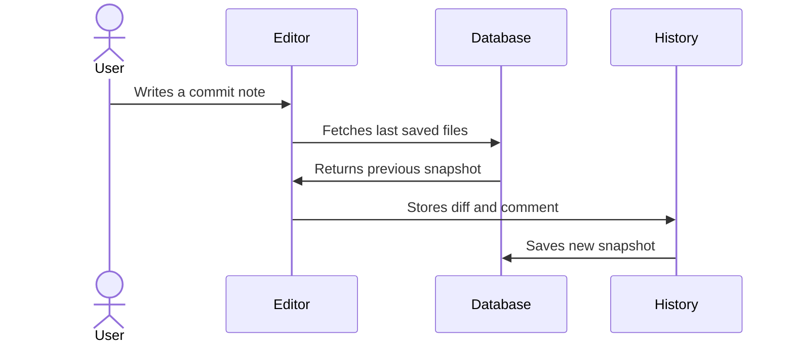
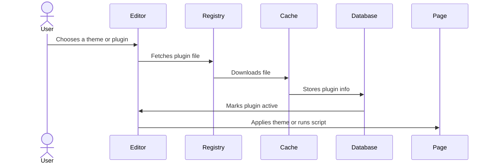

# An!on Editor

A lightweight, browser-based code playground for HTML, CSS, and JavaScript.

## Overview

An!on Editor gives front-end developers and learners a place to write, preview, and manage small web projects without leaving the browser. It keeps code, version history, tasks, and visual themes in one clean workspace so teams and solo builders can stay focused. Everything runs locally in the browser and persists between sessions, so users never have to set up a server or lose their work after closing a tab.

## System Architecture



## Features

- **Live code editor** with dedicated tabs for HTML, CSS, and JavaScript.
- **Real-time preview** rendered inside a sandboxed iframe.
- **Mirrored browser console** so `console.log`, `error`, `warn`, and `info` appear right in the editor.
- **Lightweight version control** that snapshots files and shows line-by-line diffs for each commit.
- **Integrated todo list** with color tags and human-readable timestamps.
- **Theme and plugin system** that downloads CSS themes and JS plugins on demand.
- **Library manager** for injecting external CSS and JavaScript dependencies into the preview.
- **Export options** for downloading a project as a single HTML file or backing up all local data.
- **Persistent local storage** so work, history, todos, plugins, and settings survive page reloads.

### Live Preview Flow



### Version Control Flow



### Plugin and Theme Flow



## Technologies Used

| Technology | Purpose | Link |
|---|---|---|
| TypeScript | Type-safe application logic | [typescriptlang.org](https://www.typescriptlang.org/) |
| Svelte | Reactive UI framework | [svelte.dev](https://svelte.dev/) |
| Vite | Fast build tooling and dev server | [vitejs.dev](https://vitejs.dev/) |
| CodeMirror | Language-aware code editing | [codemirror.net](https://codemirror.net/) |
| Dexie | Friendly wrapper for IndexedDB storage | [dexie.org](https://dexie.org/) |
| Beer CSS | Material Design component utilities | [beercss.com](https://www.beercss.com/) |

## Installation

- Clone the repository:

```bash
git clone <repository-url>
```

- Move into the project folder:

```bash
cd code-editor
```

- Install dependencies:

```bash
npm install
```

- Start the development server:

```bash
npm run dev
```

- Open the URL shown in your terminal, usually `http://localhost:5173`.

To create a production build:

```bash
npm run build
```

To preview the production build locally:

```bash
npm run preview
```

## Usage

When you open An!on Editor, you land in the code view with three tabs: HTML, CSS, and JavaScript. Type into any tab and the preview updates automatically.

```html
<h1>Hello, An!on</h1>
<button id="btn">Click me</button>
```

```css
body {
  font-family: sans-serif;
  text-align: center;
}
```

```js
document.getElementById('btn').addEventListener('click', () => {
  console.log('Button clicked');
});
```

The preview pane renders the result, and the console pane shows the message from `console.log`.

Use the bottom navigation to switch between:

- **Code** for editing.
- **Changes** to commit snapshots and review diffs.
- **Libraries** to add external CSS or JS files.
- **Todo** to track tasks.
- **Plugins** to install themes and extensions.
- **Settings** to toggle labels, manage metadata, and export or delete data.

To save a finished project, open Settings and choose **Export Data**, or use the export button to download a single self-contained `index.html` file.

## Contributing

Pull requests and issues are welcome. If you want to add a feature or fix a bug, open an issue first so we can discuss the change. Keep commits focused and include a short description of what changed.

## Author

Built by Ugochukwu Nweze.

- LinkedIn: [https://linkedin.com/in/ugochukwu-nweze-08812a2b8](https://linkedin.com/in/ugochukwu-nweze-08812a2b8)
- X: [https://x.com/CodesNum80638](https://x.com/CodesNum80638)

## Badges

[](https://www.typescriptlang.org/)
[](https://svelte.dev/)
[](https://vitejs.dev/)
[](https://codemirror.net/)
[](https://dexie.org/)
